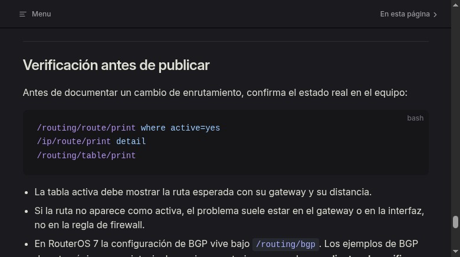

# Hermes Infrastructure

**Demo reproducible de una wiki técnica construida con VitePress y documentada
con asistencia de IA. Incluye tres páginas de muestra, una propuesta de cambio
verificada en su propia rama y el registro histórico del respaldo automatizado.**

Autor: **Stiven Polania — aprendiz del Tecnólogo en Gestión de Redes de Datos
del SENA**.

## Qué puedes verificar aquí

Tres afirmaciones, cada una con su evidencia en el repositorio:

1. **Compila desde un clon limpio.** `git clone` + `npm ci` + `vitepress build`
   producen 6 páginas HTML y las 5 rutas de la demo responden 200. No hay
   dependencias locales ni pasos que solo funcionen en mi máquina.
2. **La propuesta está probada en su rama.** Un cambio real de documentación
   vive en `propuesta/verificacion-routing-routeros7`: compila, se sirve y la
   sección aparece en el HTML. En `main` no está, y por eso sigue siendo una
   propuesta.
3. **El respaldo automático es histórico.** El último respaldo automático es del
   6 de octubre de 2026. Se documenta como diseño y como registro de lo que
   existió, no como automatización que hoy corre.

```bash
git clone https://github.com/kylandr/hermes-infrastructure.git
cd hermes-infrastructure/site && npm ci
npx vitepress build        # 6 HTML en .vitepress/dist
npx vitepress preview      # 5 rutas con 200
```

El repositorio es público: el clon funciona sin cuenta ni credenciales. Si
prefieres `gh`, `gh repo clone kylandr/hermes-infrastructure` hace lo mismo
(con `gh` instalado, ese comando usa SSH y requiere una clave configurada).

### Una distinción que este repositorio mantiene explícita

**Que la página compile no prueba los comandos.** La compilación demuestra que el
Markdown es válido, que el frontmatter se respeta y que el sitio se genera; no
ejecuta nada en un equipo. Los comandos de RouterOS de la propuesta se probaron
solo contra la documentación oficial y **falta ejecutarlos en un router del
laboratorio**: por eso la rama no se fusiona. Cada afirmación del repositorio
dice cuál de las dos cosas se comprobó.

---

## 1. Objetivo

Demostrar, con un sistema real y verificable, un ciclo completo de
documentación técnica asistida por IA:

1. **Capturar** conocimiento de redes y sistemas (pfSense, Cisco, Huawei,
   MikroTik, Aruba, Linux, Windows Server, Docker, GLPI, Zabbix, seguridad).
2. **Producir** páginas con estructura uniforme y fuentes citadas.
3. **Publicar** un sitio estático navegable y con búsqueda.
4. **Conservar** el histórico del contenido y de la configuración del agente
   en un repositorio Git.

El interés no está en la cantidad de páginas, sino en el **flujo**: cómo una
orden en lenguaje natural termina siendo una página compilada y versionada, y
qué partes de ese flujo son automatización real y cuáles solo están descritas.

---

## 2. Mi aporte

- **Diseño del flujo de documentación**: definición del formato de página
  (frontmatter con `title`, `tags`, `created`, `updated`, `sources`,
  `confidence`), del orden de secciones y de la regla de compilar y verificar
  antes de declarar un tema como documentado.
- **Especificación del comportamiento del agente** (archivos de instrucciones
  por perfil): solo documenta bajo orden explícita, una búsqueda y como máximo
  dos extracciones por tema, páginas modulares, frontmatter obligatorio,
  compilación posterior y commit descriptivo.
- **Estructura de la wiki**: 13 categorías iniciales organizadas por dominio
  (fabricante de red, sistema operativo, servicio), con índices generados por
  script y barra lateral derivada del sistema de archivos.
- **Automatización**: generación de índices por categoría, compilación
  VitePress y publicación del sitio; respaldo versionado del contenido y de la
  configuración del agente.
- **Integración de un servidor MCP de terceros** (Google Flow) con
  modificaciones propias, documentada en `docs/MCP-GOOGLE-FLOW.md`.

La inferencia y la escritura las ejecuta el agente; el diseño del flujo, las
reglas, la estructura y la verificación son aporte propio. Esa separación se
mantiene explícita en todo el repositorio: no se presentan como propias las
páginas redactadas por el agente ni el código de los proyectos de terceros.

---

## 3. Arquitectura

```
                        Tailscale (red privada)
                    ┌──────────────┴──────────────┐
                    │                             │
          ┌─────────▼─────────┐         ┌─────────▼──────────┐
          │ Estación Arch     │         │ VPS Oracle (ARM)   │
          │                   │         │  (siempre activo)  │
          │ • Hermes Agent    │         │ • Hermes Agent     │
          │   perfil default  │         │   perfiles wiki/git│
          │ • Gateway         │         │ • wiki-server      │
          │ • Puente WhatsApp │         │   (VitePress, HTTP)│
          │ • Navegador CDP   │         │ • cron semanal     │
          └─────────┬─────────┘         └─────────┬──────────┘
                    │                             │
                    │   contenido .md + rebuild   │
                    └──────────────┬──────────────┘
                                   │
                        ┌──────────▼───────────┐
                        │ wiki/  (fuente .md)  │
                        │ .vitepress/config    │
                        │ rebuild.sh → build   │
                        └──────────┬───────────┘
                                   │ git commit / push
                        ┌──────────▼───────────┐
                        │ Repositorio privado  │
                        │ (contenido + config) │
                        └──────────────────────┘
```

Capas:

| Capa | Componente | Función |
|------|-----------|---------|
| Red | Tailscale | Enlace privado entre estación y VPS, sin puertos públicos |
| Cómputo | Estación Arch / VPS Oracle ARM | Ejecución del agente y del sitio |
| Agente | Hermes Agent (perfiles separados) | Redacción, publicación, respaldo |
| Publicación | VitePress + `rebuild.sh` | Sitio estático con búsqueda local |
| Persistencia | Git | Histórico de contenido y configuración |

---

## 4. Hitos (fechas respaldadas por Git)

Todas las fechas provienen de commits reales; la columna *Evidencia* indica
dónde verificarlas. **Primer respaldo documentado: 5 de octubre de 2026**
(creación del repositorio de respaldo a las 16:14 UTC).

| Fecha | Hito | Evidencia |
|-------|------|-----------|
| 2026-10-05 | Arranque de la wiki: primeras páginas de pfSense, Zabbix, GLPI y fabricantes de red | repo de la wiki, commit inicial `54eeadc` ("Ingesta: pfSense VLAN installation"); 90 commits entre 2026-10-05 y 2026-11-07 |
| 2026-10-05 16:14 UTC | Creación del repositorio de respaldo | `ebcb3fe` "Init: repositorio de backup Hermes" |
| 2026-10-05 | Primera documentación completa del sistema (arquitectura, componentes, flujos, bots, respaldo) | `a3e3412` "Docs: documentacion completa del proyecto", 9 documentos en `docs/` |
| 2026-10-06 03:34 UTC | Último respaldo automático registrado | `16452b1` "Backup: 2026-10-06 03:34 UTC" (último commit del repo de respaldo) |
| 2026-10-25 | Trabajo sobre el MCP de Google Flow: modo turbo, pestañas paralelas, dirección cinematográfica | repo `flow-studio-mcp`, 8 commits de ese día (`13afde3` … `b201e32`) |
| 2026-10-26 | Cierre del pipeline v2.5 (3 ingredientes, lote imagen-a-vídeo, esquemas planos) | `e1a15ea` "release: pipeline v2.5 completo" |
| 2026-10-31 | v2.6: esquema completo de 3 ingredientes y sincronía de audio | `242a63c` "feat(v2.6)…" |
| 2026-11-07 | Actualización de la wiki en producción (AdGuard Home, homepage, limpieza de Zabbix) | repo de la wiki, `0c766d5` "docs: adguard home + homepage" |

Lectura honesta del histórico: el contenido creció en dos ráfagas (5–6 de
octubre y 7 de noviembre) y el respaldo automático **se detuvo el 6 de octubre**.
El repositorio de respaldo no contiene nada posterior a esa fecha.

---

## 5. Estado comprobado: respaldo, sincronización y revisión

Verificado el 2026-11-16 contra el entorno en ejecución. Se separa lo que
**funciona** de lo que solo está **documentado** o quedó **detenido**, porque el
respaldo privado no refleja el estado actual del sistema.

| Pieza | Estado | Comprobación |
|-------|--------|--------------|
| Wiki publicada (VitePress) | **Funciona** | `wiki-server` activo; `GET /wiki/` → HTTP 200; 139 páginas `.md` |
| Generación de índices + compilación (`rebuild.sh`) | **Funciona** | script presente en el servidor de la wiki; recompila y reinicia el servicio |
| Agente que redacta y publica | **Funciona** | un cron semanal de novedades existe y se dispara (última ejecución intentada 2026-11-16) |
| Respaldo automático diario | **Histórico (detenido)** | último commit de respaldo 2026-10-06 03:34 UTC; no existe el script `hermes-backup.sh` en el VPS ni un cron de respaldo en la lista actual |
| Sincronización estación ↔ VPS cada 2 min | **No presente** | no hay `~/wiki` ni temporizador de sincronización en la estación; el flujo descrito no corre |
| Revisión previa de cambios | **No implementada** | el agente escribe y hace commit directo, sin rama ni aprobación; la revisión ocurre después, con `git diff`. Ver `docs/FLUJO-DOCUMENTACION.md` |
| Integración MCP de Google Flow | **En evaluación** | handshake y pruebas parciales superadas; falta una ejecución completa desde Hermes. Ver `docs/MCP-GOOGLE-FLOW.md` |
| Configuración de VitePress dentro del respaldo | **Ausente** | el respaldo no incluye `.vitepress/`: solo el contenido y `rebuild.sh`. El sitio privado compila con una configuración que vive únicamente en el servidor |

En corto: **el respaldo diario es histórico** —funcionó hasta el 6 de octubre de
2026 y no volvió a ejecutarse—, la sincronización automática no está instalada y
no existe una revisión previa al commit. Las tres piezas se describen como
diseño y como registro, no como automatización activa.

---

## 6. Evidencia depurada del flujo

Salida real, recortada, de la comprobación del ciclo documentación → publicación
(2026-11-16):

```
$ systemctl is-active wiki-server      # servicio de sistema en el VPS
active

$ curl -s -o /dev/null -w '%{http_code}\n' http://<vps>:8080/wiki/
200

$ find ~/wiki/wiki -name '*.md' | wc -l
139

$ cd ~/wiki && git log --oneline | wc -l
90
```

Respaldo:

```
$ cd ~/hermes-backup && git log -1 --format='%ad %h %s' --date=iso
2026-10-06 03:34:32 +0000 16452b1 Backup: 2026-10-06 03:34 UTC

$ ls ~/bin/hermes-backup.sh ~/.hermes/scripts/hermes-backup.sh
No such file or directory        # el automatismo descrito ya no existe
```

Servidor MCP de Google Flow (handshake MCP real por stdio):

```
$ printf '%s\n' "$INIT" "$TOOLS_LIST" | node dist/index.js
INFO  Google Flow Browser MCP server running on stdio
{"result":{"protocolVersion":"2024-11-05","serverInfo":{"name":"flow-studio-mcp","version":"2.0.0"}}}
# 16 herramientas expuestas, entre ellas: flow_create_scene,
# flow_animate_card_to_video, flow_assemble_full_story, flow_export_reel

$ npx vitest run tests/sanitize.test.js tests/pure-gaps.test.js
Test Files  2 passed (2)
     Tests  15 passed (15)
```

Comandos reproducibles y su salida completa están en `evidencia/`.

### Demo VitePress verificada

La demo no se describe: se compiló y se sirvió.

```
$ npx vitepress build
vitepress v1.6.4
✓ building client + server bundles...
✓ rendering pages...
build complete in 2.20s.

$ npx vitepress preview --port 8100
/                       -> 200      /wiki/pfsense/vlans     -> 200
/guia/flujo-de-cambios  -> 200      /wiki/hermes/agentes-ia -> 200
/wiki/mikrotik/routing  -> 200
```

Además, un clon limpio del repositorio (`git clone` + `npm ci`) vuelve a
compilar y produce los mismos 6 HTML: el repositorio es autocontenido y
`.gitignore` no oculta nada necesario. Capturas en `evidencia/`.

---

## 7. Propuesta abierta: una sección nueva en la página de routing

La demo incluye una propuesta real de cambio, **sin fusionar**, para enseñar el
ciclo completo: rama, compilación, diff y decisión.



| Dato | Valor |
|------|-------|
| Rama | `propuesta/verificacion-routing-routeros7` |
| Alcance | 1 archivo, `site/wiki/mikrotik/routing.md` (+19 −1) |
| Contenido | comandos de comprobación de la tabla de rutas, criterio de diagnóstico y aviso de que los ejemplos BGP están sin verificar |
| Estado | **Pendiente de revisión**, no fusionada a `main` |

### Qué se verificó al compilarla

No se asumió: se compiló **desde la rama** y se sirvió con el servidor de
previsualización.

```
$ npx vitepress build          # desde la rama
build complete in 2.59s.       # 6 HTML generados

$ npx vitepress preview
/                       -> 200      /wiki/pfsense/vlans     -> 200
/guia/flujo-de-cambios  -> 200      /wiki/hermes/agentes-ia -> 200
/wiki/mikrotik/routing  -> 200

$ curl -s .../wiki/mikrotik/routing | grep verificacion-antes-de-publicar
id="verificacion-antes-de-publicar"      # la sección existe en el HTML
```

Y la contraprueba, para que no haya duda de dónde vive el cambio:

```
$ git switch main && npx vitepress build && npx vitepress preview
/wiki/mikrotik/routing -> 200
# "Verificación antes de publicar" no aparece: la propuesta sigue solo en la rama
```

También se comprobó que el árbol completo (incluida la rama) compila desde un
clon limpio. El diff y el registro de la comprobación están en
`evidencia/propuesta-routing.diff` y `evidencia/propuesta-verificacion-routing.md`.

### Compilar la página no es probar los comandos

Son dos comprobaciones distintas y el repositorio no las mezcla:

| Comprobación | Qué demuestra | Estado |
|--------------|---------------|--------|
| Compilación de la página (rama) | el Markdown es válido, el frontmatter se respeta y el sitio se genera con la sección nueva | **Hecha** |
| Ejecución de los comandos en RouterOS 7 | que la ruta aparece como activa y el diagnóstico es correcto en un equipo real | **Pendiente** |

Los comandos (`/routing/route/print`, `/ip/route/print`, `/routing/table/print`)
provienen de la documentación oficial de RouterOS 7, pero **no se ejecutaron en
un router del laboratorio**. Mientras eso no ocurra, la sección no se fusiona:
la propuesta queda como material de revisión, no como procedimiento publicado.

---

## 8. Contenido de este repositorio

```
.
├── README.md                    # este documento
├── docs/
│   ├── ARQUITECTURA.md          # diseño del sistema (versión pública)
│   ├── FLUJO-DOCUMENTACION.md   # propuesta → revisión → publicación
│   ├── MCP-GOOGLE-FLOW.md       # integración en evaluación
│   ├── REVISION.md              # qué se comparte y qué requiere edición
│   └── ALCANCE.md               # qué se excluyó y por qué
├── site/                        # demo VitePress verificada
│   ├── .vitepress/config.mjs
│   ├── index.md
│   ├── guia/flujo-de-cambios.md
│   └── wiki/{hermes,mikrotik,pfsense}/*.md
└── evidencia/                   # compilación, pruebas y propuesta de cambio
```

Cómo ver la demo:

```
cd site
npm install
npx vitepress dev      # http://localhost:5173
npx vitepress build    # salida en .vitepress/dist
npx vitepress preview  # http://localhost:4173, necesario con cleanUrls
```

---

## 9. Qué **no** está en este repositorio

- Credenciales, tokens, `.env`, `auth.json` ni configuración real del agente.
- Direcciones internas (IP de la malla privada, nombres de host, puertos de
  administración) y datos personales (teléfono, correo, cuentas).
- Habilidades (skills) de Hermes Agent: son contenido de terceros, no aporte
  propio, y se excluyeron completas.
- Código del MCP de Google Flow: solo se documenta; su licencia y autoría se
  respetan y el proyecto original sigue en su repositorio.

Detalle y criterio en `docs/ALCANCE.md` y la lista de archivos en
`evidencia/archivos-propuestos.txt`.

---

## 10. Créditos y nombres de terceros

- **Hermes Agent** (Nous Research): plataforma de agentes sobre la que corre el
  sistema. No se incluye su código; las habilidades que trae se excluyeron.
- **VitePress**: generador del sitio. Dependencia declarada en `site/package.json`.
- **Google Flow MCP**: proyecto de terceros bajo licencia MIT, autor
  **Mitansh Prajapati** (`Mitanshp5`), con aportes de `madzabreu`. Se evaluó y se
  documentó, pero **no se copia** su código en este repositorio.
- Repositorios relacionados evaluados y descartados para esta demo: `GTAI-1/flow-mcp`
  (licencia ISC) y `kodelyx/flow-agent`.
- Los fabricantes y productos que aparecen en las páginas de la wiki (pfSense,
  Cisco, Huawei, MikroTik, Aruba, Docker, Zabbix, GLPI, Windows Server) son
  marcas de sus respectivos titulares y se citan solo como tema documentado.

---

## 11. Licencia

**Pendiente de decisión, no resuelta en este borrador.** El proyecto original
era privado y declaraba "uso personal", así que no hay licencia pública
heredable. Este repositorio **no incluye archivo `LICENSE`** a propósito: la
elección es del autor.

Opciones sobre la mesa:

| Opción | Alcance | Efecto |
|--------|---------|--------|
| MIT | texto, scripts y configuración propios | permite reutilización con atribución |
| CC BY 4.0 (documentación) + MIT (scripts) | separa contenido y código | habitual en documentación técnica |
| Sin licencia | todo | se puede leer, no reutilizar legalmente |

El código de terceros (MCP de Google Flow) mantiene su licencia original. Ver
`docs/ALCANCE.md` y `docs/REVISION.md` para el resto de decisiones abiertas.
